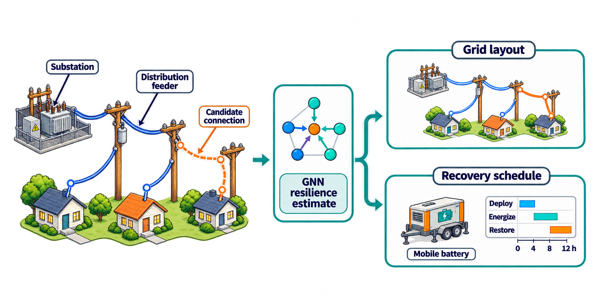
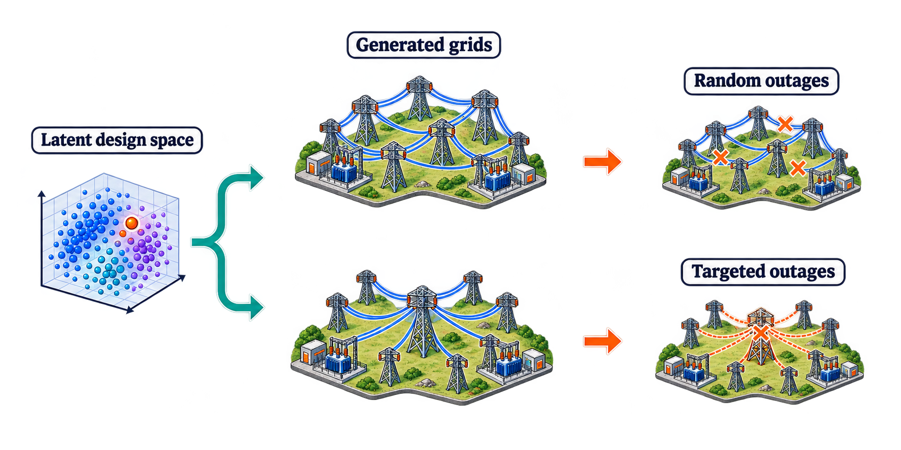
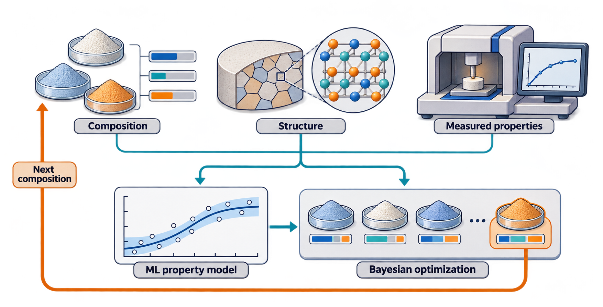
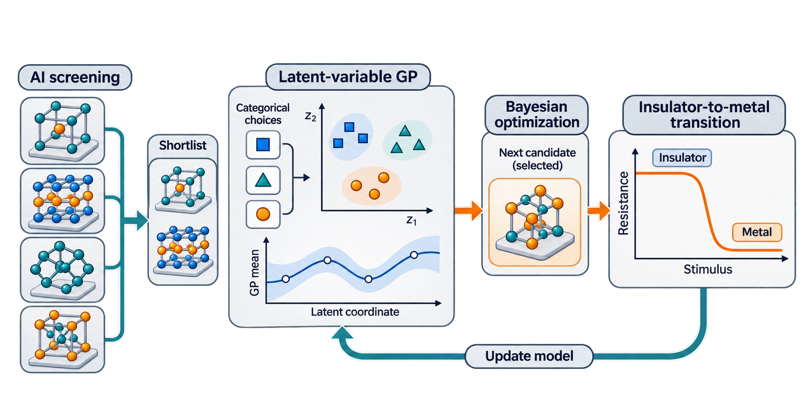
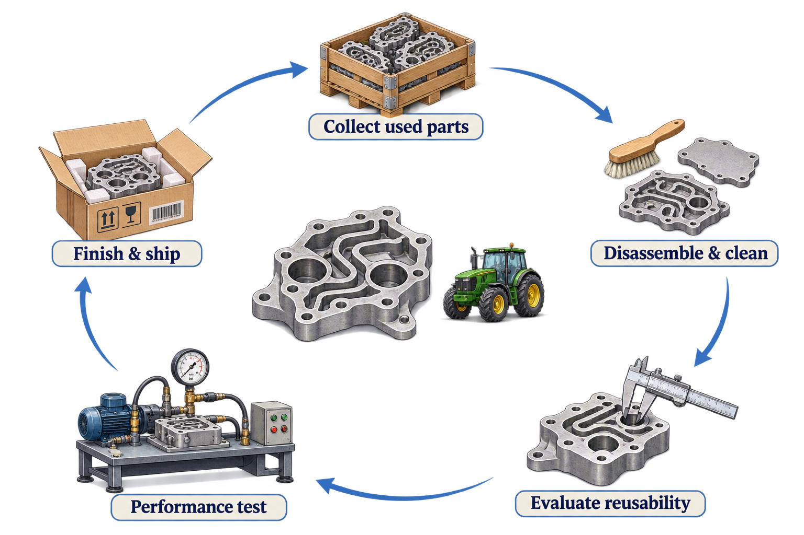
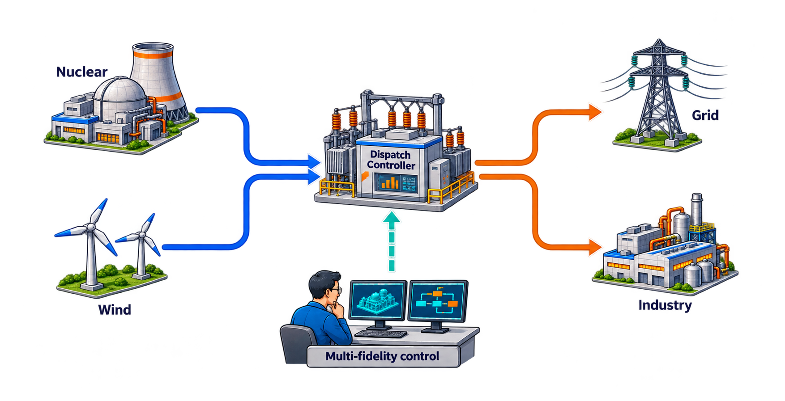

**Design Optimization**, **Data-Driven Design**, Design for Resilience, Stochastic Optimization, Metaheuristic Optimization, **Complex Systems**, Network Analysis, **Machine Learning**, Surrogate Modeling, Adaptive Sampling
 
 

# Data-Driven Design for System Networks

## Co-design Optimization of Power Grids using Graph Neural Network Regression Model
Design optimization using metaheuristic algorithms (derivative-free optimization) require numerous amount of evaluations. 
As the computational cost accumulates, even for simulations that only require a few minutes can take days to converge to a solution.
For such cases, a surrogate model that approximates the costly evaluation can come in handy.
In this research, a co-design framework is proposed that utilizes graph neural networks for data-driven optimization along with a novel metaheuristic algorithm for graph structures.

* [Control Co-design of Distribution Networks for network structure and recovery scheduling (RESS)](https://doi.org/10.1016/j.ress.2026.112511)

 

## Generative Design of Power Grids for Resilience
Since network data are unstructured and non-euclidean, it is difficult to apply conventional design methodologies and optimization algorithms that functions well on a numerical domain. 
A sophisticated solution is by utilizing a graph generative model based on graph neural networks. 
The following papers are a consecutive research effort on the use of graph GAN, from data collection to stochastic design optimization. 
Using a generative model, the network information including the topology and functional features are mapped to a numerical latent space, where a random sampling in this domain allows design exploration. 

* [Design for Resilient Transmission Networks Using a Generative Model (JMD)](https://doi.org/10.1115/1.4067745)
* [Design of Transmission Networks under Stochastic Disruption Scenarios (JMD)](https://doi.org/10.1115/1.4070127)

 
 

# Research Projects
## HT-MAX: High-throughput Materials Discovery for Extremes (10/2026 – Ongoing)  
- Project funded by U.S. Army Research Laboratory
- Responsibilities: creating a machine learning model to find the relationship 
between the materials composition, structure, and properties of compositionally complex ceramics; build ML  
and data-driven tools for quantifying uncertainties and guide adaptive discovery using Bayesian optimization

## Accelerated Design, Discovery, and Deployment of Electronic Phase Transitions (09/2026 – Ongoing) 
- Project funded by NSF DMREF
- Responsibilities: design and discovery materials exhibiting insulator-to-metal transitions for 
semiconductors using AI-aided screening and adaptive discovery; materials design optimization using 
Bayesian optimization and LVGP - a Gaussian process model that can handle categorical variables

## Data-Driven Design Decision Support for Remanufacturing of High-Value Components in Industrial and Agricultural Equipment (11/2023 – 09/2025) 
- Project funded by REMADE Institute
- Responsibilities: collaborating with industrial partner (John Deere) to create models for 
evaluating economic and environmental impact of manufacturing and remanufacturing equipment, conducting 
failure mode analysis, cost analysis, and establish framework for design for reman (DfRem); expand concept 
to system-level with multiple parts; estimate system behavior through data-driven modeling

* [Probabilistic System-Level Cost Modeling for Design for Remanufacturing (JMD)](https://doi.org/10.1115/1.4071043)
* [Design for Remanufacturing Framework: A Case Study of Hydraulic Manifold (JMD)](https://doi.org/10.1115/1.4067746)

## Multi-timescale Nuclear-Renewable Hybrid Energy Systems Operations to Improve Electricity System Resilience, Reliability, and Economic Efficiency (09/2022 – 12/2023)
- Project funded by DOE
- Responsibilities: establishing an open-source repository to share the dataset and codes for resilient 
power networks through deep generative approach for disruption management; establishing a lab setup for 
hardware-in-the-loop (HIL) test for integrated energy system (IES) control

* [Co-Design Optimization of Combined Heat and Power-based Microgrids (JRSE)](https://doi.org/10.1063/5.0165676)

